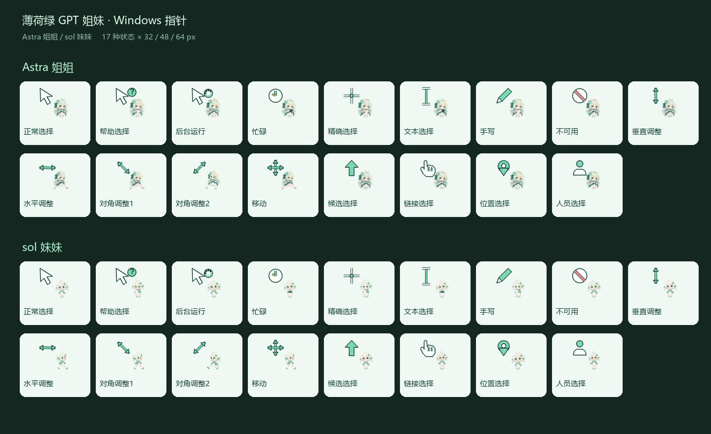
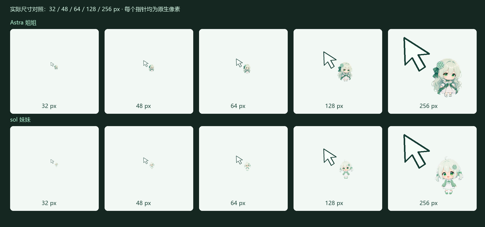
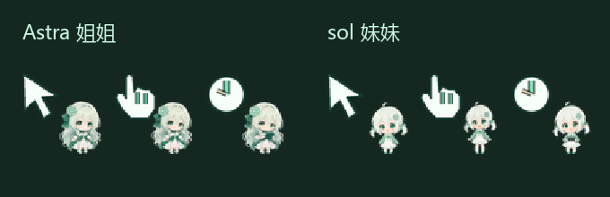
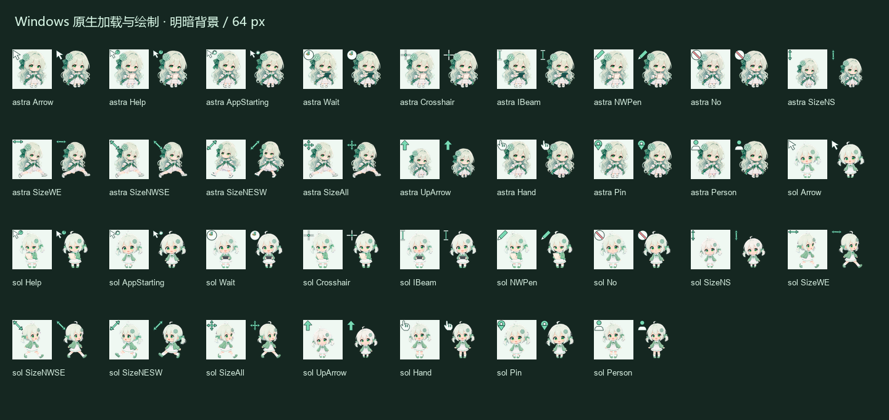

# Astra & sol · 薄荷绿 GPT 姐妹 Windows 指针

Astra 姐姐和 sol 妹妹各自一套动态指针，沿用此前姐妹的 Q 版定稿和已制作的动作。姐姐是薄荷绿长卷发、白裙和蝴蝶结；妹妹是浅绿短发、绿开衫和水手领。两套独立选择，角色会随指针状态改变动作。



## 下载与安装

下载 [整个仓库 ZIP](https://github.com/nibushiyigeren123-bot/astra-sol-mint-cursors/archive/refs/heads/main.zip) 后解压，或下载 `downloads/` 中的单角色 ZIP。打开解压目录，在 PowerShell 中运行：

```powershell
powershell -NoProfile -ExecutionPolicy Bypass -File .\install.ps1
```

安装器把文件复制到当前用户 `%LOCALAPPDATA%\AstraSolMintCursors\1.0.0`，并登记指针方案，不需要管理员权限。默认只登记方案；打开“控制面板 → 鼠标 → 指针”即可选择角色。32、48、64、128、256 五档均可选。

**请通过应用脚本或带 `-Apply` 的命令切换尺寸。** Windows 默认的方案重载在制作机上将五档都显示为32px，单在“鼠标 → 指针”里选择大文件可能仍然很小。现在安装器按指定像素应用全部17种状态，并逐项读取生效后的系统位图尺寸确认。32px为原来的大小，48px为1.5倍宽高，64px为2倍，128px为4倍，256px为8倍；日常可以先试64px。

下载完整包后可直接双击 `应用_Astra_64px.cmd`、`应用_Astra_128px.cmd`、`应用_Astra_256px.cmd`，妹妹对应 `应用_sol_64px.cmd` 等。单角色包包含对应角色的快捷脚本。此步骤会改当前指针和指针大小，原设置及尺寸一起备份。若原生替换请求或实际尺寸检查失败，会恢复原设置并报出失败状态；恢复自身失败时给出备份路径。重新登录或其他软件重置指针后，可再次双击应用脚本。

也可以直接指定角色和尺寸并应用：

```powershell
powershell -NoProfile -ExecutionPolicy Bypass -File .\install.ps1 -Character astra -Size 128 -Apply
powershell -NoProfile -ExecutionPolicy Bypass -File .\install.ps1 -Character sol -Size 256 -Apply
```

`-Apply` 会在复制目录的 `backup/` 保存当前指针注册表值。恢复最近一次应用前的设置：

```powershell
powershell -NoProfile -ExecutionPolicy Bypass -File .\install.ps1 -Restore
```

不运行脚本时，可在鼠标的“指针”页逐项浏览 `cursors/astra/48/` 或 `cursors/sol/48/` 的文件并保存方案。

## 内容

每套 17 种状态：正常、帮助、后台运行、忙碌、精确、文本、手写、不可用、垂直/水平/两种对角调整、移动、候选、链接、位置、人员。

每档包括 17 个透明动态 `.ani`，每个有4至8帧。正常选择的角色待机/眨眼；链接和人员选择挥手；后台运行思考等待；忙碌和文本选择拿着小平板工作；不可用表现失落；水平/对角调整和移动配跑动；垂直调整与候选选择配轻跳；帮助、精确和手写配查看纸张。语义符号尖端或中心的点击热点始终固定，角色在侧边动画，不跟随角色手脚改变点击位置。

| 指针状态 | 角色动作 |
|---|---|
| 正常选择 | 待机、眨眼 |
| 帮助 / 精确 / 手写 | 查看纸张 |
| 后台运行 / 位置选择 | 思考、等待 |
| 忙碌 / 文本选择 | 拿平板工作 |
| 链接 / 人员选择 | 挥手 |
| 不可用 | 失落表情 |
| 水平 / 对角调整 / 移动 | 跑动 |
| 垂直调整 / 候选选择 | 轻跳 |

动画帧采用此前通过检查的九状态桌宠图集，保留每种动作自己的比例和循环；细小品牌饰品仍存在生成绘制差异。完整文件名/中文映射、动作、热点、帧数和速度见 `source/cursor_manifest.json`。




## 可编辑源与校验

`source/characters/` 保存透明角色定稿和两张九状态动作图集；完整下载包的 `source/frames/` 保存各档透明 PNG 帧；`source/build_cursors.py` 保存符号绘制、尺寸、热点和 ANI 编码逻辑，可重新制作。Git 仓库保留角色图集及生成器，输出PNG可通过生成器重建，完整包提供全部输出帧。

```powershell
python -m pip install -r requirements.txt
python source/build_cursors.py
python scripts/validate_cursors.py
python source/render_showcase.py
```

源码生成器使用 Windows 自带字体，视频生成器需要 FFmpeg。文件校验器检查所有ANI的二进制边界、透明像素、动画差异，并用Windows `LoadImageW`、`GetIconInfo`、`DrawIconEx` 实际加载文件、检查热点、绘制动画步骤及比较颜色。`validation.json` 是文件验收记录，`checksums.json` 为分发文件SHA-256。

修复版已在制作机通过真实安装器逐一应用两位角色的五档尺寸，检查170个已生效的系统状态及各动画帧，大小、热点、颜色和动画变化全部匹配。参见 `live-application-validation.json`。另外在隔离注册表中检查方案登记、备份恢复和两个实际触发的失败回退分支；失败注入使用模拟原生调用。修复了制作机上带广播标志的指针重载返回失败、导致应用提前回退的问题；重载采用flags=0，随后明确加载尺寸并核对实际系统结果。不同DPI、远程桌面和各类游戏环境仍需实际使用验证。

Windows 原生加载审查：



## 来源和使用说明

角色身份参考沿用用户提供的姐妹截图及 [B 站视频 BV1xSa76yEqZ](https://www.bilibili.com/video/BV1xSa76yEqZ/)，视频简介提及多数人物素材来自 [ZipZipPipe](https://space.bilibili.com/4168597)，尚未逐张确认原图作者。这里使用的是此前本地模型重绘的 Q 版定稿，未包含参考截图、原视频或模型权重。角色源与旧 [姐妹桌宠项目](https://github.com/nibushiyigeren123-bot/astra-sol-codex-pets) 对应。

ChatGPT/OpenAI 图标归对应权利人；这是社区制作分享，非官方产品。代码采用 `LICENSE-CODE` 中的 MIT 许可证；此许可证不为角色美术、参考素材或品牌标识授予额外权利。

`previews/showcase.mp4` 是75.2秒、1920×1080、30fps的完整模拟演示，Astra与sol分别展示全部17种状态，包含运动、状态名称、角色动作、窗口调整和尺寸对照，无配乐。B 站投稿文字见 `B站投稿文案.md`。
