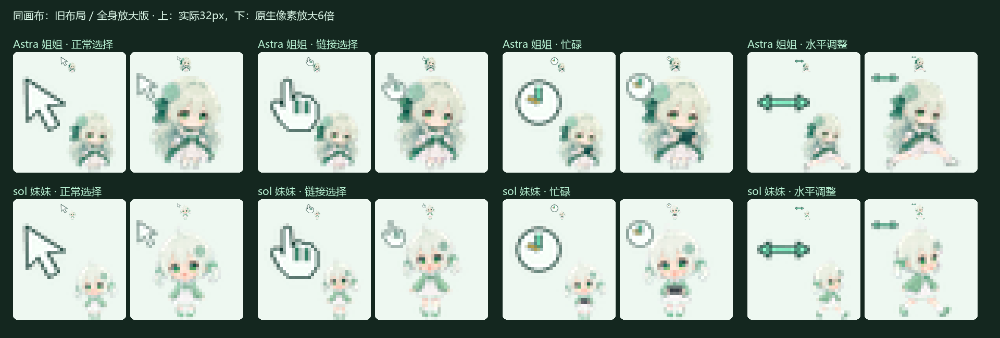
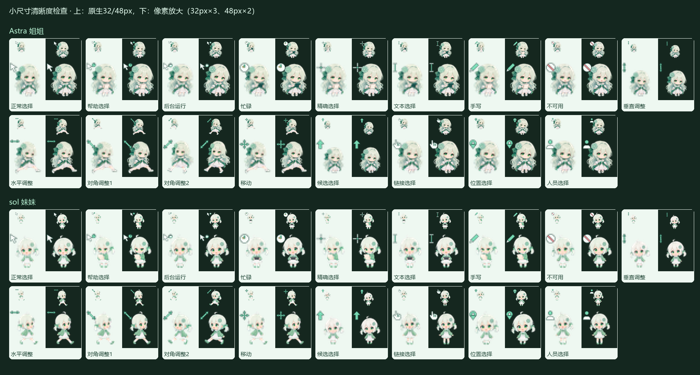

# Astra & sol · 薄荷绿 GPT 姐妹 Windows 指针

Astra 姐姐和 sol 妹妹各自一套动态指针，沿用此前姐妹的 Q 版定稿和已制作的动作。姐姐是薄荷绿长卷发、白裙和蝴蝶结；妹妹是浅绿短发、绿开衫和水手领。两套独立选择，角色会随指针状态改变动作。v1.0.4把32、48、64、128、256px五档全部改为角色优先布局：保留完整全身动作，减少留白，缩小功能符号；各档均从原始动作图集重新生成。32px的像素有限，优先保证轮廓、发型与动作可辨认，细节仍以更大尺寸为准。




## 下载与安装

**补充：换完指针后，如果发现大小不对，再双击 `尺寸保持_开启.cmd` 即可。**

**推荐用法：安装指针 → 开启“尺寸保持” → 想要什么大小就双击对应的安装/应用 CMD。不要再调整 Windows 的指针大小滑块。**

## 第一次使用

1. 下载完整包或单角色包，完整解压到新文件夹。不要在压缩包里直接运行文件，也不要只拿出一个安装文件；保留 `cursors/`、`source/` 和脚本的相对位置。
2. 先安装一档指针。最省步骤的方式是双击 `应用_Astra_64px.cmd` 或 `应用_sol_64px.cmd`，它会安装并应用对应角色的64px指针。日常推荐64px。
3. 安装完成后，双击 `尺寸保持_开启.cmd`。首次使用必须先安装指针文件，再开启组件；否则会提示先安装指针。已经安装当前版的人可直接开启；从旧版升级的人请先用新包的对应尺寸 CMD 重新安装，更新角色素材。
4. 开启一次即可，组件会随当前用户登录启动。需要换大小时继续按下面的方法操作。

## 换大小、换姐妹

尺寸保持开启后，直接双击所需的现成 CMD 文件，安装并应用对应角色与大小。每次会处理全部17种指针状态。

| 大小 | Astra 姐姐 | sol 妹妹 |
|---|---|---|
| 32px | `应用_Astra_32px.cmd` | `应用_sol_32px.cmd` |
| 48px | `应用_Astra_48px.cmd` | `应用_sol_48px.cmd` |
| 64px（日常推荐） | `应用_Astra_64px.cmd` | `应用_sol_64px.cmd` |
| 128px | `应用_Astra_128px.cmd` | `应用_sol_128px.cmd` |
| 256px | `应用_Astra_256px.cmd` | `应用_sol_256px.cmd` |

完整包同时提供两位角色和全部五档；单角色包只提供对应角色的五档。比如想用大号妹妹，就双击 `应用_sol_128px.cmd` 或 `应用_sol_256px.cmd`。无需修改文件名，也无需调整 Windows 的大小滑块。

## 习惯 INF 右键安装的人

也可以右键 `安装_Astra_64px.inf` 或 `安装_sol_64px.inf` →“安装”（Windows 11 可能要先选“显示更多选项”），再到“控制面板 → 鼠标 → 指针”，选择对应的 `Astra Mint 64px` / `sol Mint 64px` 方案并点“应用”。随后双击 `尺寸保持_开启.cmd`。

INF 只复制文件并登记方案，右键安装后还要选择方案并点应用；写入 Windows 目录时可能需要管理员确认。想直接点击一次就换大小，使用上表的“应用_…px.cmd”更方便。INF 安装和应用 CMD 本身都不会自动开启尺寸保持，需要手动开启一次。

## 请不要调整 Windows 的指针大小滑块

本包已收到用户反馈：在“设置 → 辅助功能 → 鼠标指针和触控”调整指针大小时，姐妹指针可能被恢复成 Windows 默认指针。本版保留这一已知兼容问题，使用时通过本包的对应尺寸安装/应用文件选择大小，不使用系统大小滑块。

如果已经误调、变回默认指针：

1. 重新双击想用的 `应用_Astra_…px.cmd` 或 `应用_sol_…px.cmd`，恢复角色与尺寸。
2. 如果尺寸保持被关闭或卸载了，再双击 `尺寸保持_开启.cmd`。
3. 此后通过对应尺寸 CMD 切换，不再拖动系统大小滑块。

仅使用 INF 而不开尺寸保持时，Windows 重载动画可能缩回默认大小。不要把文件分辨率或方案名称当成系统实际生效尺寸；想稳定使用指定大小，请保持尺寸保持组件开启。

## 停用与恢复默认指针

- `尺寸保持_关闭.cmd`：停止组件并取消登录启动，保留指针文件和方案。关闭本身不会立刻把当前指针恢复成默认。
- `尺寸保持_开启.cmd`：重新启用组件。
- `尺寸保持_卸载.cmd`：停止并移除组件，保留指针素材与方案。

想回到 Windows 默认指针，先关闭尺寸保持，再到“控制面板 → 鼠标 → 指针”选择原来的 Windows 方案并点“应用”。

尺寸保持首次开启时会从包内源码在本机生成组件，因此压缩包不含预编译 EXE；启用后在后台运行并随登录启动。正常情况下无需重复开启；若换完指针后大小不对，再双击 `尺寸保持_开启.cmd` 即可。无需自己输入终端命令。


## 内容

每套 17 种状态：正常、帮助、后台运行、忙碌、精确、文本、手写、不可用、垂直/水平/两种对角调整、移动、候选、链接、位置、人员。

每档包括 17 个透明动态 `.ani`，每个有4至8帧。正常选择的角色待机/眨眼；链接和人员选择挥手；后台运行思考等待；忙碌和文本选择拿着小平板工作；不可用表现失落；水平/对角调整和移动配跑动；垂直调整与候选选择配轻跳；帮助、精确和手写配查看纸张。语义符号尖端或中心的点击热点始终固定，角色保留全身动作，功能符号缩小放在左上角，不跟随角色手脚改变点击位置。

| 指针状态 | 角色动作 |
|---|---|
| 正常选择 | 待机、眨眼 |
| 帮助 / 精确 / 手写 | 查看纸张 |
| 后台运行 / 位置选择 | 思考、等待 |
| 忙碌 / 文本选择 | 拿平板工作 |
| 链接 / 人员选择 | 挥手 |
| 不可用 | 失落表情 |
| 水平 / 对角调整 / 移动 | 跑动 |
| 垂直调整 / 候选选择 | 轻跳 |

动画帧采用此前通过检查的九状态桌宠图集，保留每种动作自己的比例和循环；细小品牌饰品仍存在生成绘制差异。完整文件名/中文映射、动作、热点、帧数和速度见 `source/cursor_manifest.json`。





## 可编辑源与校验

`source/characters/`保存透明角色定稿和两张九状态动作图集；`source/build_cursors.py`保存符号绘制、尺寸、热点和ANI编码逻辑，可从原始图集重新生成全部170个ANI及1100张PNG。完整安装包包含两位角色五档指针、原始图集、生成器与视频编辑脚本；为适应GitHub上传接口限制，已生成的1100张原始透明PNG单独提供为可选的[编辑帧包](https://github.com/nibushiyigeren123-bot/astra-sol-mint-cursors/raw/refs/heads/main/downloads/astra-sol-editable-frames-v1.0.4.zip)。普通安装仅需完整安装包；直接编辑输出帧时，把编辑帧包解压到完整包的同一目录并合并`source/frames/`。也可运行生成器自行重建PNG，无需下载编辑帧包。原始PNG、全部源码和版本历史另完整保存在本地工程存档。

以下重建命令用于完整包或仓库源码；单角色包提供安装所需文件。

```powershell
python -m pip install -r requirements.txt
python source/build_cursors.py
python scripts/validate_cursors.py
python source/render_showcase.py
```

源码生成器使用 Windows 自带字体，视频生成器需要 FFmpeg。文件校验器检查所有ANI的二进制边界、透明像素、动画差异，并用Windows `LoadImageW`、`GetIconInfo`、`DrawIconEx` 实际加载文件、检查热点、绘制动画步骤及比较颜色。`validation.json` 是文件验收记录，`checksums.json` 为分发文件SHA-256。

v1.0.4对全部170个新布局文件完成上述原生加载检查。`character-layout-validation.json`逐项检查五档角色占比增大、各动作裁切仅移除透明像素，以及所有动画帧热点固定；小尺寸明暗背景成图另经人工查看。整个动作共用裁切范围与锚点，保留动作中的位移，不对每一帧单独拉伸。

安装逻辑沿用v1.0.3；此前通过25项隔离入口检查：实际启动全部10份CMD子进程、无参数PS1、保留当前角色、单角色包、显式尺寸、仅登记/仅验证和六种开关冲突；隔离测试的原生调用使用stub，没有改当前系统指针。参见 `default-install-validation.json`。

此前v1.0.3在制作机通过真实安装器逐一应用两位角色的五档尺寸，检查170个已生效的系统状态及各动画帧，大小、热点、颜色和动画变化全部匹配；该记录为旧布局的历史验收。v1.0.4新布局另对全部170个文件实际原生加载并逐帧核验，参见validation.json。参见 `live-application-validation.json`。另外在隔离注册表中检查方案登记、备份恢复和两个实际触发的失败回退分支；失败注入使用模拟原生调用。修复了制作机上带广播标志的指针重载返回失败、导致应用提前回退的问题；重载采用flags=0，随后明确加载尺寸并核对实际系统结果。不同DPI、远程桌面和各类游戏环境仍需实际使用验证。

Windows 原生加载审查：


## 来源和使用说明

角色身份参考沿用用户提供的姐妹截图及 [B 站视频 BV1xSa76yEqZ](https://www.bilibili.com/video/BV1xSa76yEqZ/)，视频简介提及多数人物素材来自 [ZipZipPipe](https://space.bilibili.com/4168597)，尚未逐张确认原图作者。这里使用的是此前本地模型重绘的 Q 版定稿，未包含参考截图、原视频或模型权重。角色源与旧 [姐妹桌宠项目](https://github.com/nibushiyigeren123-bot/astra-sol-codex-pets) 对应。

ChatGPT/OpenAI 图标归对应权利人；这是社区制作分享，非官方产品。代码采用 `LICENSE-CODE` 中的 MIT 许可证；此许可证不为角色美术、参考素材或品牌标识授予额外权利。

`previews/showcase.mp4` 是75.2秒、1920×1080、30fps的完整模拟演示，Astra与sol分别展示全部17种状态，包含运动、状态名称、角色动作、窗口调整和尺寸对照。现已配乐，开头0.7秒淡入、结尾3秒淡出；画面与字幕保持原样。B 站投稿文字见 `B站投稿文案.md`，请保留其中的音乐署名。

BGM：放課後アフタースクール / watson，フリーBGM・音楽素材MusMus https://musmus.main.jp/ 。[使用条款](https://musmus.main.jp/info.html)。仅在展示成片中使用音乐，仓库与指针压缩包不分发独立音乐文件。

配乐重建脚本：`source/add_showcase_bgm.py`；参数与验收：`source/video/bgm-mix.json`。视频渲染器先生成无配乐画面，再用官方站自行取得的音乐混入：

```powershell
python source/add_showcase_bgm.py previews/showcase.mp4 YOUR_MUSMUS_BGM_174.mp3 showcase-bgm.mp4 --wav showcase-bgm.wav
```

原始剪辑音轨只保留在本地完整工程。
